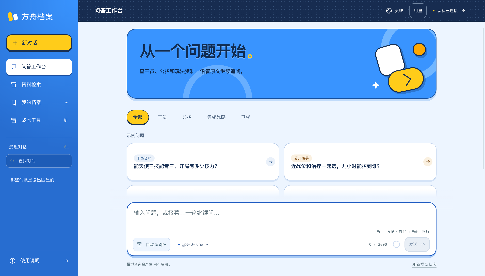
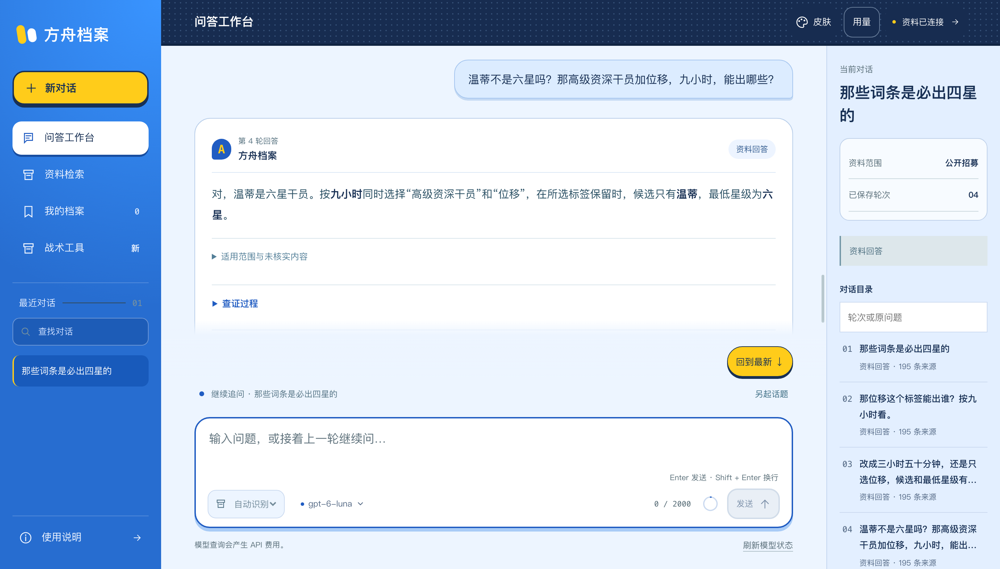
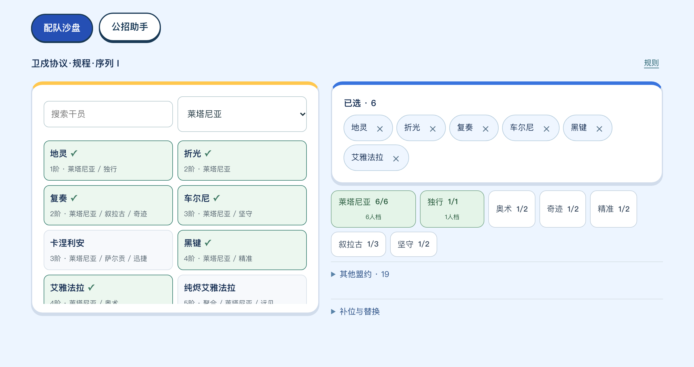

<h1 align="center">方舟档案 · Ark Archive</h1>

<strong>在自己的电脑上问明日方舟，点开来源，接着追问。</strong>

  
  
  
  
  

<a href="https://github.com/Brandon030722/ark-archive/releases/download/v0.23.0-beta.2/Ark-Archive-Windows-x64.zip"><strong>Windows x64 下载</strong></a> · <a href="https://github.com/Brandon030722/ark-archive/releases/download/v0.23.0-beta.1/Ark-Archive-macOS.zip"><strong>macOS 下载</strong></a> · <a href="#快速开始">快速开始</a> · <a href="#能用来做什么">功能预览</a> · <a href="#随仓资料库">资料来源</a> · <a href="https://github.com/Brandon030722/ark-archive/issues">反馈问题</a>

## 快速开始

| 系统 | 解压后双击 | 停止工作台 |
| --- | --- | --- |
| Windows x64 | `Start-Ark-Archive.cmd` | 双击 `Stop-Ark-Archive.cmd` 或在启动窗口按 Ctrl+C |
| macOS | `启动方舟档案.command` | 见[运行手册](docs/运行手册.md#状态停止和备份) |

把解压后的文件夹放到准备长期保留的本机位置。首次启动会下载 Python 和依赖、校验并导入资料，然后打开浏览器。Windows 安装包已包含 PostgreSQL 和 uv。以后双击原文件夹中的启动入口即可沿用资料和设置。

首次引导结束后，在**模型管理**选择服务商、填自己的 Key、选模型。想先体验可以跳过，直接使用资料检索和战术工具。

**Mac 上的手机访问**　双击 **开启局域网访问.command** 后，用同一 Wi-Fi 下的手机打开终端显示的网址。这个模式下，同网设备可通过你的 Mac 使用当前配置的模型额度。双击普通入口可切回本机模式。

首次启动需要能访问 GitHub 和 Python 软件源。[查看完整运行手册](docs/运行手册.md)

## 能用来做什么

| 想解决的问题 | 工作台如何帮你 |
| --- | --- |
| 高级资深干员和位移一起选，九小时能招到谁？ | 用收录的公招池计算组合，打开干员资料核对候选。公招助手也支持手动选标签。 |
| 上一轮提到的收藏品，在另一个肉鸽主题里也一样吗？ | 在原会话继续问，打开这轮引用核对主题和来源原文。 |
| 卫戍协议这套阵容还差哪个盟约？ | 在配队沙盘点选干员，即时查看当前人数和激活门槛。 |

查看卫戍协议配队沙盘

## 模型与隐私

支持 DeepSeek、OpenAI Responses、Anthropic Messages，以及提供兼容工具调用的 OpenAI 风格中转站。自定义模型可能需要手填上下文和费率。回答由模型规划检索，再从当前资料版本选证、组织答案和复核。点击引用可检查依据；模型仍可能误读资料。

密钥在部署电脑上加密保存，手机可切换已配置的模型。提交模型提问时，你选择的服务商或中转站会收到问题、所需对话上下文和选取的证据。计数、费用估算、挂账和查询记录保存在本机。余额显示取决于服务商提供的接口。

## 随仓资料库

首次安装从仓库内的压缩包恢复国服资料快照，含 **26,520 条知识记录、47 份来源快照**，覆盖干员、公招、集成战略和卫戍协议。卫戍资料含「规程·序列 I」。这是固定版本，游戏更新后需另行收录。每份来源的原始网址、修订号和 SHA-256 均可查阅。

[版本与校验清单](distribution/knowledge.json) · [来源与许可说明](docs/资料来源.md)

## 开发与反馈

后端采用 Python、FastAPI、LangGraph 和 PostgreSQL，前端使用原生 JavaScript。公开回归使用独立测试数据库和模拟服务商，运行方式见[运行手册](docs/运行手册.md#开发回归)。反馈问题时请附系统版本、复现步骤和已脱敏的错误信息。

自有代码采用 [MIT](LICENSE) 许可。第三方游戏资料、Wiki 内容及模型目录各自适用其来源条款。
